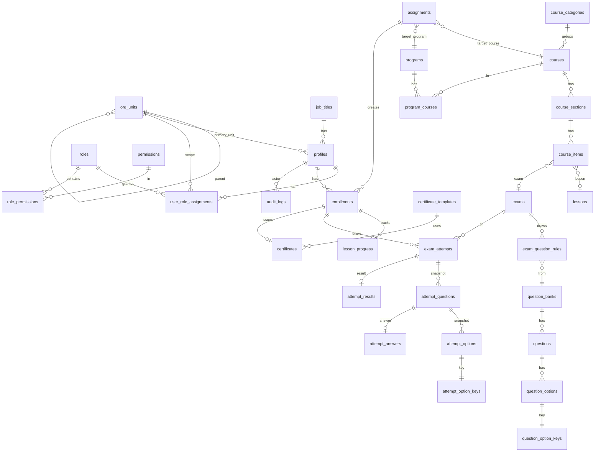

# DATABASE — MINH KỲ ACADEMY (PostgreSQL / Supabase)

> DRAFT chờ duyệt. Tên bảng/cột là đề xuất; chi tiết cuối cùng chốt trong migration ở M4. Khóa chính `uuid` (`gen_random_uuid()`), thời gian `timestamptz`, điểm `numeric(7,2)`, xóa mềm bằng `archived_at` (không xóa cứng dữ liệu đào tạo/kết quả).

## 1. ERD

## 2. Nhóm bảng

### 2.1 Tổ chức & người dùng
| Bảng | Cột chính | Ghi chú |
|---|---|---|
| `org_units` | id, parent_id, kind (`company`/`business_unit`/`branch`/`department`), code unique, name, path (text, materialized), is_active | Cây; `path` cập nhật bằng trigger; index `path text_pattern_ops` |
| `job_titles` | id, code unique, name, is_active | Chức danh |
| `profiles` | id = `auth.users.id`, employee_code unique, full_name, email, phone, primary_unit_id, job_title_id, status (`invited`/`active`/`suspended`), created_at | Không chứa vai trò. Tạo qua luồng mời bởi Admin |
| `roles` | id, code (`learner`/`manager`/`training_admin`/`system_admin`), name | Dữ liệu cấu hình, seed |
| `permissions` | code (vd `course.manage`, `exam.manage`, `report.view`, `audit.view`, `user.manage`, `org.manage`, `assignment.manage`, `question.manage`, `attempt.review`) | Seed |
| `role_permissions` | role_id, permission_code | PK kép |
| `user_role_assignments` | id, user_id, role_id, scope_unit_id, granted_by, granted_at, revoked_at | Unique (user, role, scope) còn hiệu lực. Nguồn duy nhất cho phân quyền |

### 2.2 Khóa học & chương trình
| Bảng | Cột chính |
|---|---|
| `course_categories` | id, name, position |
| `courses` | id, code, title, summary, objectives, skills, cover_path, category_id, delivery_mode (`self_paced`; `blended` dành chỗ), status (`draft`/`published`/`archived`), owner_unit_id (null = toàn tổ chức), audience_rule jsonb (đơn vị/chức danh được thấy), completion_rule jsonb (vd `all_required_items`), estimated_minutes, published_at |
| `course_sections` | id, course_id, title, position |
| `course_items` | id, section_id, position, item_type (`lesson`/`exam`), lesson_id?, exam_id?, is_required, unlock_mode (`free`/`sequential`) — check đúng một trong lesson_id/exam_id |
| `lessons` | id, content_type (`video`/`pdf`/`text`), title, storage_path, duration_seconds, body (text), created_by |
| `programs` | id, code, title, description, status |
| `program_courses` | program_id, course_id, position, is_required |

Phiên bản nội dung: MVP xuất bản = khóa hiện hành; sửa khóa đã có người học chỉ cho thêm/sắp xếp, đổi cấu trúc cần xác nhận (ghi audit). Phiên bản đầy đủ để sau.

### 2.3 Ngân hàng câu hỏi
| Bảng | Cột chính | Ghi chú |
|---|---|---|
| `question_banks` | id, name, owner_unit_id, description | |
| `questions` | id, bank_id, question_type (`single`/`multiple`/`true_false`), stem (text/markdown), media_path, difficulty (1–3), tags text[], status (`draft`/`approved`/`retired`), points numeric default 1, version int | `version` tăng khi sửa nội dung |
| `question_options` | id, question_id, position, label text | **Không có** cột đúng/sai |
| `question_option_keys` | option_id PK, is_correct | **Bảng riêng**: chỉ admin/quyền `question.manage` đọc; learner không có policy |

### 2.4 Bài thi
| Bảng | Cột chính |
|---|---|
| `exams` | id, title, description, duration_minutes, pass_percent, max_attempts, score_policy (`highest`/`latest`/`first`), shuffle_questions, shuffle_options, opens_at?, closes_at?, result_visibility (`score_only`/`show_correct_after_close`/`show_correct_after_submit`), instructions jsonb, status |
| `exam_question_rules` | id, exam_id, bank_id, question_count, difficulty?, tag?, fixed_question_ids uuid[]? — rút ngẫu nhiên theo quy tắc hoặc danh sách cố định |

Học phần/khóa chứa bài thi qua `course_items.exam_id`. Ca thi (session) riêng: Phase 2.

### 2.5 Phân công & ghi danh
| Bảng | Cột chính |
|---|---|
| `assignments` | id, target_type (`course`/`program`/`exam`), target_id, audience_type (`user`/`unit`/`job_title`), audience_id, include_subunits bool, due_at, assigned_by, created_at |
| `enrollments` | id, user_id, course_id, source (`self`/`assignment`), assignment_id?, status (`not_started`/`in_progress`/`completed`/`overdue`/`failed`), progress_percent, due_at, started_at, completed_at — unique (user_id, course_id) |
| `program_enrollments` | id, user_id, program_id, assignment_id?, due_at, status, completed_at |
| `lesson_progress` | enrollment_id, course_item_id, status (`not_started`/`in_progress`/`completed`), progress_percent, last_position_seconds, completed_at — PK (enrollment_id, course_item_id) |

Phân công tạo `enrollments` bằng RPC/job (mở rộng nhóm đối tượng thành từng người, idempotent theo unique). Nhân viên mới vào đơn vị: job đối soát. `overdue` tính từ `due_at < now()` và chưa hoàn thành (view/cột tính).

### 2.6 Lượt thi (snapshot)
| Bảng | Cột chính |
|---|---|
| `exam_attempts` | id, exam_id, user_id, enrollment_id?, attempt_no, status (`in_progress`/`submitted`/`expired_submitted`/`voided`), started_at, deadline_at, submitted_at, submit_reason (`manual`/`timeout`/`admin`), exam_snapshot jsonb (cấu hình tại thời điểm thi), idempotency_key — unique (exam_id, user_id, attempt_no); **partial unique** một lượt `in_progress` cho (exam_id, user_id) |
| `attempt_questions` | id, attempt_id, position, source_question_id, source_version, question_type, stem, media_path, points |
| `attempt_options` | id, attempt_question_id, position, label |
| `attempt_option_keys` | attempt_option_id PK, is_correct — snapshot đáp án, **không** cấp learner |
| `attempt_answers` | attempt_question_id PK, selected_option_ids uuid[], flagged, answered_at |
| `attempt_results` | attempt_id PK, score, max_score, percent, passed, graded_at, detail jsonb |

Thứ tự hiển thị = `position` đã xáo lúc tạo snapshot. Sửa/xóa câu hỏi gốc không ảnh hưởng các bảng này.

### 2.7 Chứng chỉ, audit
| Bảng | Cột chính |
|---|---|
| `certificate_templates` | id, name, layout jsonb, background_path, issuer_name, is_default |
| `certificates` | id, user_id, enrollment_id unique, code unique (`MKA-YYYY-XXXXXX`), issued_at, expires_at?, status (`valid`/`expired`/`revoked`), pdf_path, issuer_name |
| `audit_logs` | id, actor_id, action, entity_type, entity_id, before jsonb, after jsonb, ip?, created_at — append-only |

## 3. RLS — ma trận tóm tắt

Ký hiệu: **S** = chỉ dòng của mình, **M** = dòng người thuộc phạm vi quản lý, **A** = theo `has_permission(perm, unit)`, ✗ = không có policy.

| Bảng | Learner | Manager | Admin |
|---|---|---|---|
| org_units, job_titles | đọc | đọc | A ghi |
| profiles | S (đọc, sửa hạn chế) | M đọc | A |
| roles/permissions/assignments | ✗ (chỉ qua hàm) | ✗ | A (`user.manage`) |
| courses/sections/items/lessons | đọc nếu `published` + đúng đối tượng | như learner | A ghi |
| programs | đọc nếu được gán/đối tượng | đọc | A ghi |
| question_banks/questions/options | ✗ | ✗ | A (`question.manage`) |
| **question_option_keys, attempt_option_keys** | ✗ | ✗ | A đọc (`question.manage`/`attempt.review`) |
| exams | đọc cấu hình công khai nếu được gán | đọc | A ghi |
| enrollments, lesson_progress | S (ghi tiến độ của mình qua RPC/policy hẹp) | M đọc | A |
| exam_attempts, attempt_* | S đọc; **ghi chỉ qua RPC** | M đọc kết quả (không đọc đáp án chi tiết nếu chưa bật) | A đọc; hủy/mở lượt qua RPC có audit |
| certificates | S | M đọc | A |
| audit_logs | ✗ | ✗ | `audit.view` đọc; không ai UPDATE/DELETE |

Nguyên tắc: policy theo từng thao tác (SELECT/INSERT/UPDATE/DELETE) và theo role `authenticated`; `anon` không có quyền nào. Bảng `attempt_*` ghi bằng RPC — policy INSERT/UPDATE trực tiếp cho learner **không tồn tại**.

## 4. Hàm & RPC chính

| Hàm | Loại | Mục đích |
|---|---|---|
| `app.has_permission(perm, unit)` | STABLE, invoker | Kiểm tra quyền theo phạm vi cây |
| `app.manages_user(user)` | STABLE | Manager có phạm vi tới user |
| `start_exam_attempt(exam_id)` | SECURITY DEFINER | Kiểm tra điều kiện, tạo snapshot |
| `save_attempt_answer(attempt_id, attempt_question_id, option_ids, flagged)` | SECURITY DEFINER | Lưu nháp, kiểm tra hạn |
| `submit_exam_attempt(attempt_id, idempotency_key)` | SECURITY DEFINER | Nộp + chấm nguyên tử |
| `expire_overdue_attempts()` | SECURITY DEFINER, cron | Nộp tự động lượt quá hạn |
| `get_attempt_for_user(attempt_id)` | SECURITY DEFINER | Trả câu hỏi **không** có khóa; kết quả theo `result_visibility` |
| `record_lesson_progress(...)` | invoker/RPC hẹp | Cập nhật tiến độ, tính hoàn thành khóa |
| `expand_assignment(assignment_id)` | RPC admin | Tạo enrollments idempotent |
| `issue_certificate(enrollment_id)` | SECURITY DEFINER | Cấp khi đủ điều kiện, idempotent theo enrollment |

## 5. Chỉ mục & ràng buộc quan trọng

- `enrollments(user_id, status)`, `enrollments(course_id, status)`, `enrollments(due_at) where status not in ('completed')`.
- `exam_attempts(user_id, exam_id)`, partial unique `(exam_id, user_id) where status='in_progress'`, `(deadline_at) where status='in_progress'` cho job quét.
- `courses(status, category_id)`, trigram/FTS trên `courses.title` cho tìm kiếm.
- `org_units(path text_pattern_ops)`; `user_role_assignments(user_id) where revoked_at is null`.
- CHECK: `pass_percent between 0 and 100`, `duration_minutes > 0`, `course_items` đúng một loại nội dung, `deadline_at > started_at`.
- Trigger: cập nhật `path` của `org_units`; ghi `audit_logs` cho thay đổi nhạy cảm (kể cả sửa `question_option_keys`); chặn UPDATE/DELETE trên `audit_logs`, `attempt_*` đã `submitted`.

## 6. Seed demo (`supabase/seed.sql`)

Tách hoàn toàn khỏi dữ liệu thật, có đánh dấu `is_demo`/email miền demo. Nội dung: cây đơn vị mẫu (Minh Kỳ Group → Ô tô VinFast, Xe máy điện VinFast/TAILG, Gara sửa chữa ô tô, Phụ tùng, Văn phòng; vài chi nhánh), chức danh, tài khoản demo mỗi vai trò, vài khóa học ngắn do Minh Kỳ tự soạn, ngân hàng ~40 câu, một bài thi, phân công mẫu. Mật khẩu demo sinh khi seed local, không commit.
